

# Arquímedes D. Chacón Ch.

<em>Quantitative Research • Psychometrics • Statistical Software Engineering</em>

  
  
  
  
  

  
  

---

### About me

I am a psychologist with a Ph.D. and over 20 years of experience working at the intersection of quantitative research, higher education, and data science. Throughout my academic career (as a Senior Professor at UCAB and UNIMET) and my work in organizational consulting, I have specialized in turning complex quantitative methodology into accessible, teaching-oriented tools.  My current focus merges advanced data analysis (Python, R, SQL, Power BI) with edtech and open-source statistical software development. I build jamovi modules such as AssumptionsLab, FiabilityLab, EGAnetLab and MokkenLab, specifically created to provide pedagogical support, simplify assumption checking, and enhance methodological training for researchers and students.  

I combine published scientific research with the creation of educational software and research tools designed to make data analysis intuitive, rigorous, and actionable.

### Sobre mí
<i>Soy psicólogo con doctorado y más de 20 años de experiencia en la intersección entre la investigación cuantitativa, la educación superior y la ciencia de datos aplicada. A lo largo de mi trayectoria académica (como Profesor Titular en la UCAB y UNIMET) y mi práctica en consultoría organizacional, me he especializado en transformar la complejidad metodológica en herramientas accesibles y didácticas.  Mi enfoque actual combina el análisis avanzado de datos (Python, R, SQL, Power BI) con el desarrollo de software educativo y estadístico de código abierto. Soy creador de módulos para jamovi como AssumptionsLab, FiabilityLab, EGAnetLab y MokkenLab, diseñados específicamente para brindar acompañamiento pedagógico, facilitar la verificación rigurosa de supuestos e impulsar el aprendizaje práctico de la estadística en entornos universitarios e investigadores.  

Combino la investigación científica publicada con el diseño de soluciones EdTech y herramientas de apoyo metodológico que humanizan la enseñanza de los datos y optimizan la toma de decisiones basada en evidencia. </i>

---

<table>
<tr>
<td>
<picture>
  <source media="(prefers-color-scheme: dark)" srcset="assumptionslab-logo-dark.svg">
  
</picture>
</td>
</tr>
<tr>
<td>

*Evaluates the statistical assumptions behind group comparisons, ANOVA, the full regression family, path analysis, and time series.*
*Every diagnostic comes paired with evidence-based methodological guidance, not just a test statistic.*

</td>
</tr>
</table>

**AssumptionsLab** is an open-source jamovi module that evaluates the statistical assumptions behind common analytical techniques — independent and related-groups comparisons, ANOVA/ANCOVA, linear/logistic/ordinal/multinomial regression, path analysis, and time series — pairing every diagnostic with evidence-based methodological guidance and interpretation rather than just reporting isolated test statistics.

- **10 analysis modules**, from group comparisons to the full regression family (linear, logistic, ordinal logistic, multinomial logistic) to path analysis and time series (ARIMA/SARIMA/ETS/VAR/VECM/GARCH).
- A built-in **Assumption Library**, a bilingual glossary of every assumption and test. Each method-backed result cites its source in jamovi's native reference format, and the complete **APA 7th edition bibliography** lives in the module's documentation.
- Every result reported in **English and Spanish**.
- **60 automated edge-case tests** running in CI on every push.

*AssumptionsLab es un módulo de código abierto para jamovi que evalúa los supuestos estadísticos detrás de las técnicas analíticas más comunes — comparación de grupos independientes y relacionados, ANOVA/ANCOVA, regresión lineal/logística/ordinal/multinomial, path analysis y series de tiempo — acompañando cada diagnóstico con orientación metodológica basada en evidencia e interpretación, en vez de solo reportar estadísticos aislados.*

- *10 módulos de análisis, desde comparación de grupos hasta la familia completa de regresión (lineal, logística, ordinal, multinomial), pasando por path analysis y series de tiempo (ARIMA/SARIMA/ETS/VAR/VECM/GARCH).*
- *Biblioteca de Supuestos integrada, un glosario bilingüe de cada supuesto y prueba. Cada resultado respaldado por un método cita su fuente en el formato de referencias nativo de jamovi, y la bibliografía completa en APA 7 está en la documentación del módulo.*
- *Cada resultado reportado en inglés y español.*
- *60 pruebas automatizadas de casos límite corriendo en CI en cada push.*

  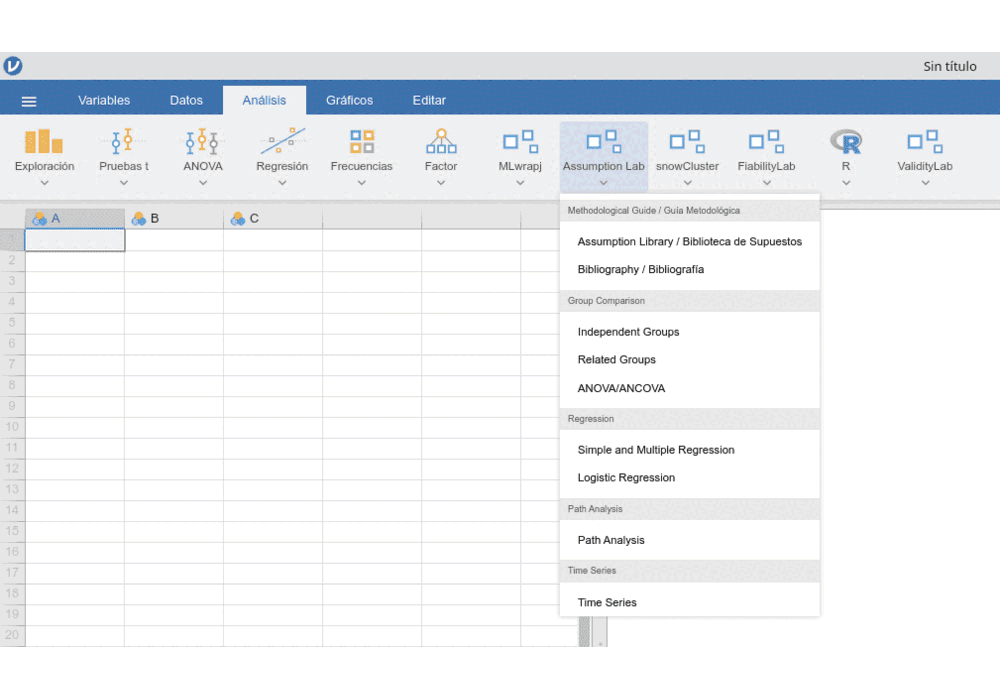

<strong>📸 Ver capturas de AssumptionsLab</strong>

  <table width="100%" style="border: none; border-collapse: collapse;">
    <tr>
      <td align="center" width="50%" style="border: none;">
        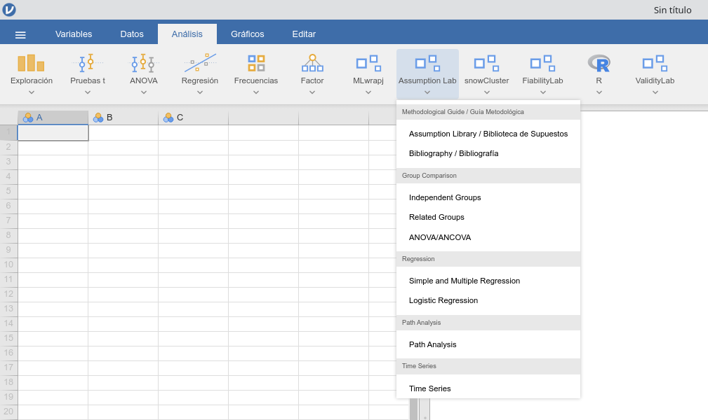
        
<em>Suite integrada en Jamovi</em>

      </td>
      <td align="center" width="50%" style="border: none;">
        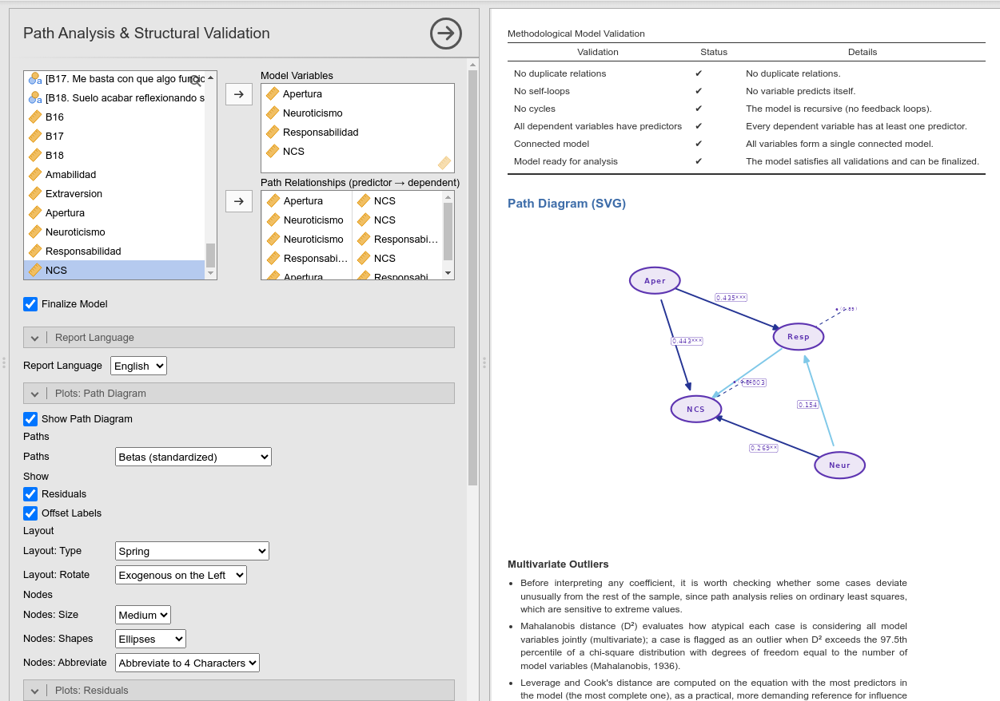
        
<em>Path Analysis y Validación Estructural</em>

      </td>
    </tr>
    <tr>
      <td align="center" width="50%" style="border: none;">
        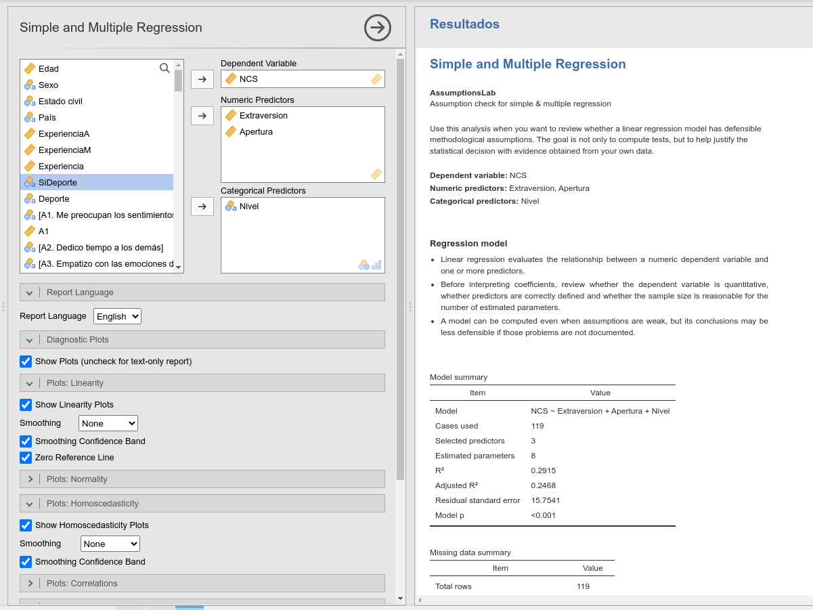
        
<em>Modelos de Regresión y Diagnóstico</em>

      </td>
      <td align="center" width="50%" style="border: none;">
        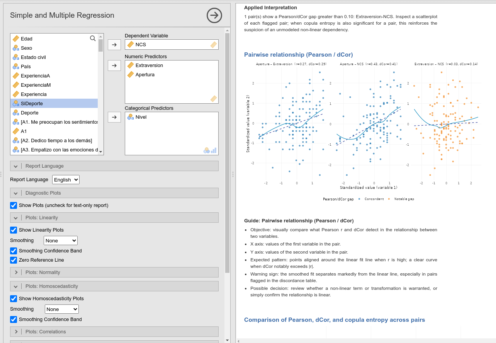
        
<em>Comparación de Métricas de Asociación</em>

      </td>
    </tr>
    <tr>
      <td align="center" width="50%" style="border: none;">
        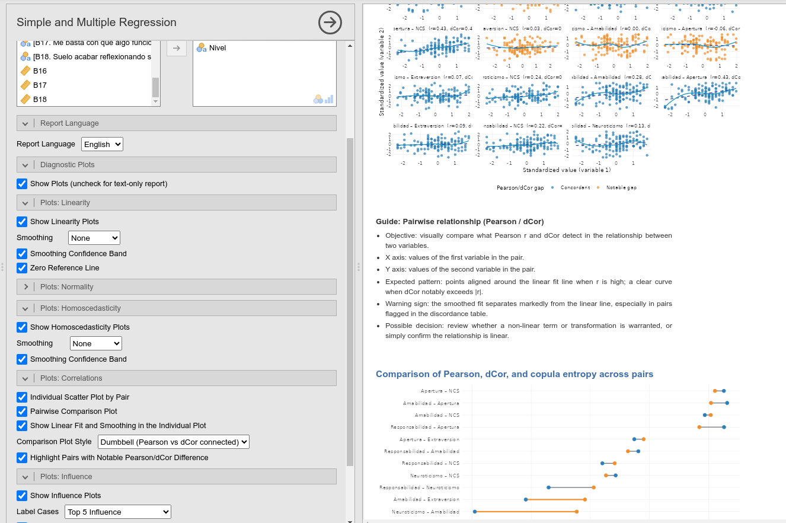
        
<em>Gráficos de Influencia y Dispersión</em>

      </td>
      <td align="center" width="50%" style="border: none;">
        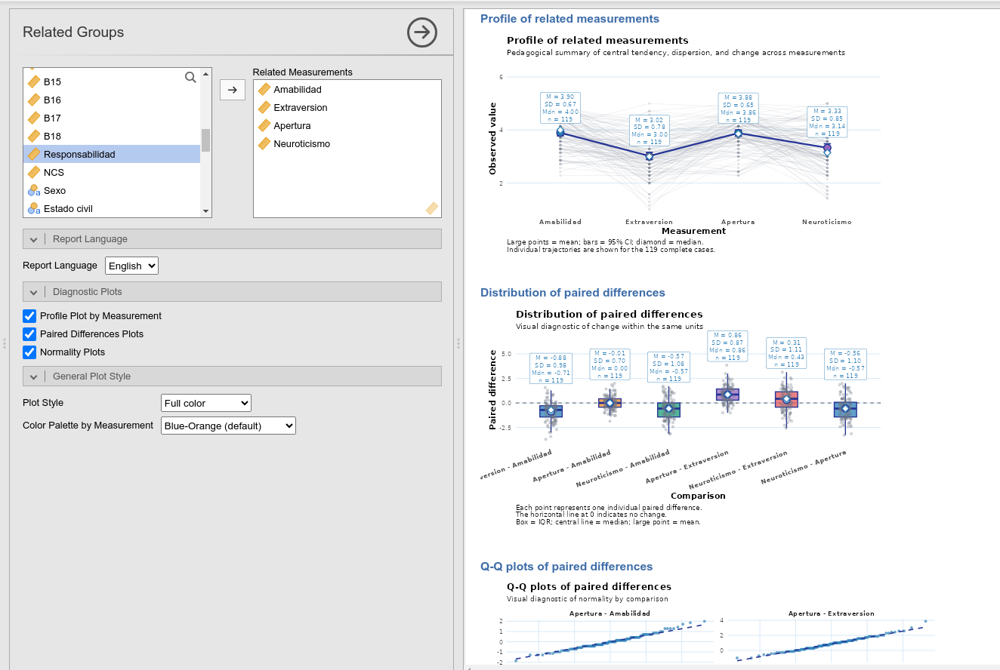
        
<em>Análisis de Grupos Relacionados</em>

      </td>
    </tr>
    <tr>
      <td align="center" width="50%" style="border: none;">
        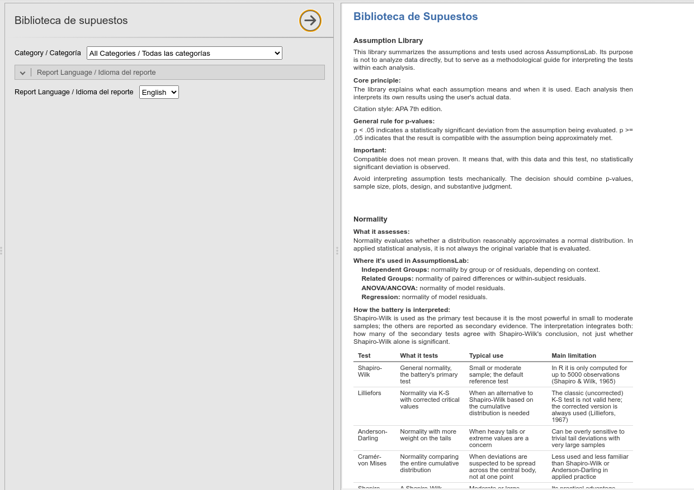
        
<em>Biblioteca de Supuestos Metodológicos</em>

      </td>
      <td align="center" width="50%" style="border: none;">
        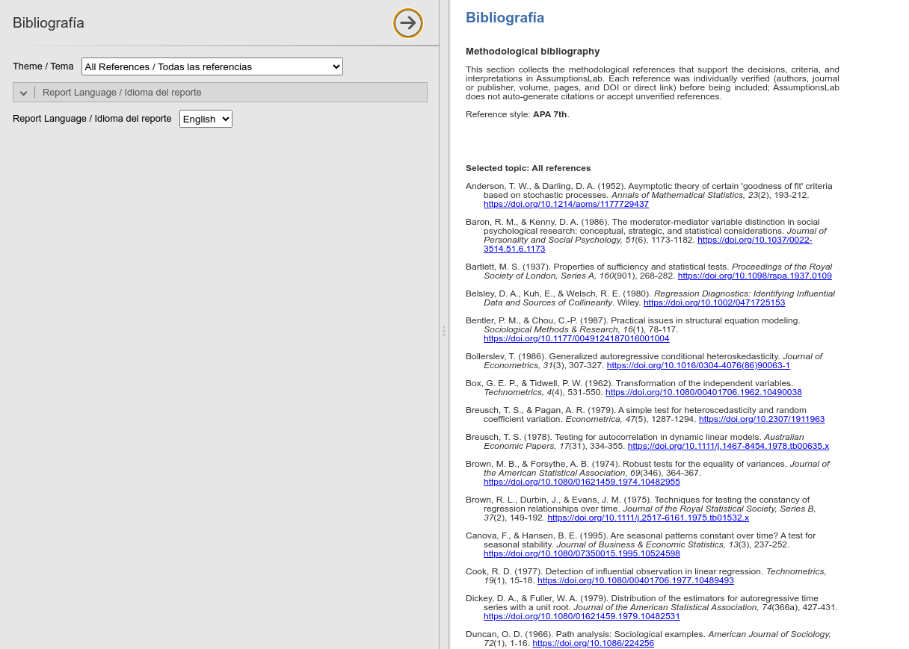
        
<em>Referencias y Estilo APA Integrado</em>

      </td>
    </tr>
  </table>

---

<table>
<tr>
<td>
<picture>
  <source media="(prefers-color-scheme: dark)" srcset="fiabilitylab-logo-dark.svg">
  
</picture>
</td>
</tr>
<tr>
<td>

*Evaluates measurement reliability and agreement — internal consistency, inter-rater agreement, SEM-based reliability, and measurement invariance.*
*Every coefficient comes with its assumptions and limitations, plus a panel that flags disagreement between coefficients.*

</td>
</tr>
</table>

**FiabilityLab** is an open-source jamovi module for evaluating measurement reliability and agreement — internal consistency, inter-rater agreement, confirmatory-factor-based (SEM) reliability, and measurement invariance across groups — pairing every coefficient with its assumptions, limitations, and an explanation of what it does and does not support, rather than just reporting isolated numbers.

- **6 analyses**: Internal Consistency, Inter-Rater Agreement, Advanced Reliability (SEM), Measurement Invariance, plus a built-in Library and Bibliography.
- A coefficient **discordance panel** that flags and explains disagreement between coefficients for the same design (e.g. Alpha ≫ Omega, Kappa ≪ Gwet's AC1), instead of only reporting whichever one was selected.
- Every result reported in **English and Spanish**.
- **36 automated tests** running in CI on every push.

*FiabilityLab es un módulo de código abierto para jamovi que evalúa la confiabilidad y el acuerdo en la medición — consistencia interna, acuerdo entre jueces, confiabilidad basada en análisis factorial confirmatorio (SEM), e invariancia de medición entre grupos — acompañando cada coeficiente con sus supuestos, limitaciones y una explicación de qué respalda y qué no, en vez de solo reportar números aislados.*

- *6 análisis: Consistencia Interna, Acuerdo entre Jueces, Confiabilidad Avanzada (SEM), Invariancia de Medición, además de una Biblioteca y Bibliografía integradas.*
- *Panel de discordancia entre coeficientes que señala y explica el desacuerdo entre coeficientes para el mismo diseño (p. ej. Alfa ≫ Omega, Kappa ≪ AC1 de Gwet), en vez de solo reportar el que se seleccionó.*
- *Cada resultado reportado en inglés y español.*
- *36 pruebas automatizadas corriendo en CI en cada push.*

  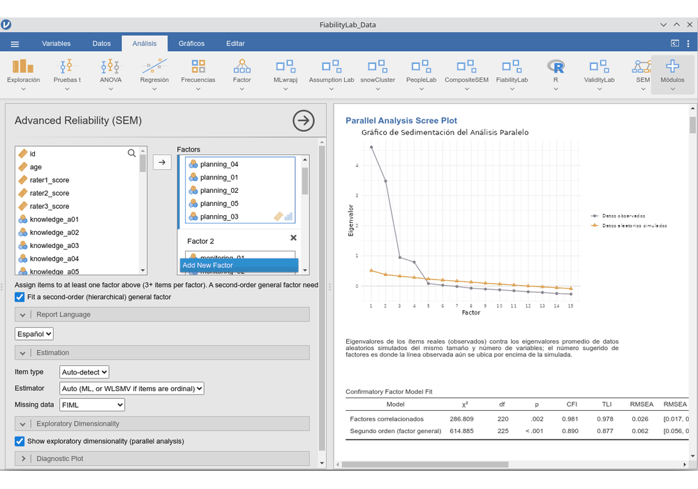

---

<table>
<tr>
<td>
<picture>
  <source media="(prefers-color-scheme: dark)" srcset="eganetlab-logo-dark.svg">
  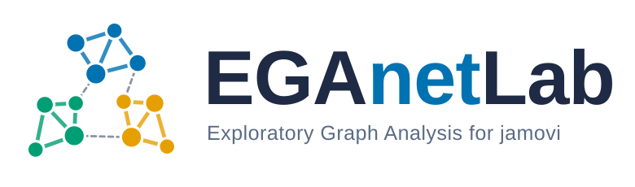
</picture>
</td>
</tr>
<tr>
<td>

*Exploratory Graph Analysis for jamovi: how many dimensions a set of items measures, which items belong together, and how much that answer can be trusted.*
*Every option explained, every result interpreted — submission to the jamovi Library in preparation.*

</td>
</tr>
</table>

**EGAnetLab** is an open-source jamovi module that brings the network psychometrics of the [EGAnet](https://r-ega.net) R package to jamovi. It estimates the items' network of partial correlations and its communities (the dimensions), and then builds the evidence around that answer: bootstrap stability, redundancy, information-theoretic fit, hierarchical and wording-effect structures, invariance across groups and change over time.

- **2 analyses, all of EGAnet's core in v0.1.0:** EGA with a choice of correlation, network model and community algorithm; bootEGA with item and dimension stability; UVA redundancy; network loadings and scores; TEFI comparison of competing structures; CFA, also on random exploration/confirmation subsamples; hierEGA and riEGA; invariance and NetworkComparisonTest (including paired pre/post samples); qgraph/bootnet centrality and edge accuracy; and Dynamic EGA for intensive longitudinal data.
- Every report opens with a **key findings summary**: main findings, uncertainties and warnings.
- Three bundled public datasets and **more than 100 automated tests**, including stress tests with missing data and small samples, running in CI on every push.
- Continuous, ordinal and dichotomous items, with highly customisable network plots in colourblind-safe palettes.
- Every option with an explanatory paragraph and every result reported in **English and Spanish**.

*EGAnetLab es un módulo de código abierto para jamovi que lleva el Análisis Exploratorio de Grafos del paquete de R EGAnet a jamovi. Estima la red de correlaciones parciales entre ítems y sus comunidades (las dimensiones), y luego construye la evidencia alrededor de esa respuesta: estabilidad por bootstrap, redundancia, ajuste, estructuras jerárquicas y efectos de redacción, invarianza entre grupos y cambio en el tiempo.*

- *2 análisis con todo el núcleo de EGAnet en la v0.1.0: EGA con elección de correlación, modelo de red y algoritmo de comunidades; bootEGA con estabilidad de ítems y dimensiones; redundancia con UVA; cargas y puntuaciones de red; comparación de estructuras con TEFI; AFC, también con SubMuestras de Exploración y Confirmación; hierEGA y riEGA; invarianza y NetworkComparisonTest (incluido pre/post); centralidad y precisión de aristas con qgraph y bootnet; y EGA dinámico para datos longitudinales intensivos.*
- *Cada informe abre con un Resumen de hallazgos: hallazgos principales, incertidumbres y advertencias.*
- *Tres conjuntos de datos públicos incluidos y más de 100 pruebas automatizadas, con pruebas de esfuerzo de datos ausentes y muestras pequeñas, corriendo en CI en cada push.*
- *Ítems continuos, ordinales y dicotómicos, con gráficos de red altamente configurables.*
- *Cada opción con su párrafo explicativo y cada resultado reportado en inglés y español.*

  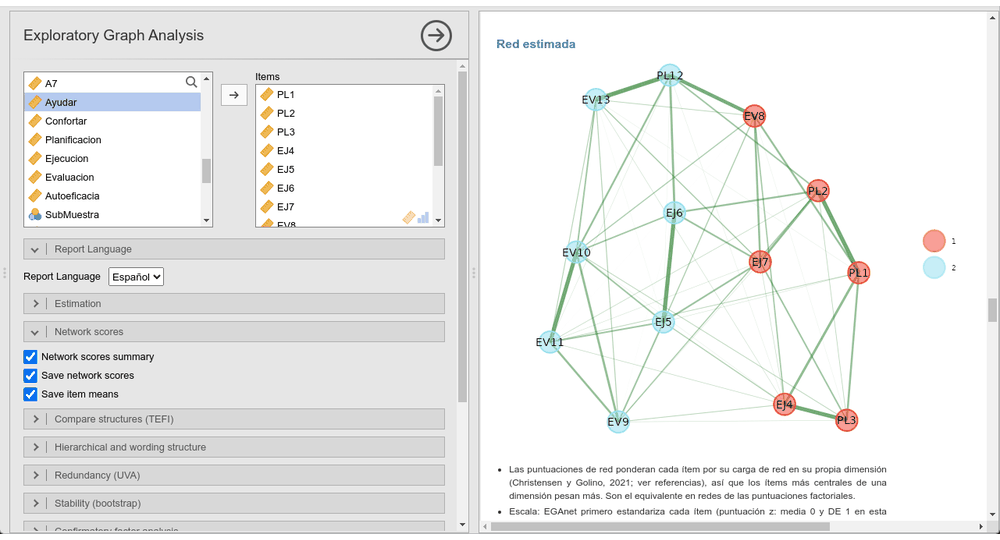

---

<table>
<tr>
<td>
<picture>
  <source media="(prefers-color-scheme: dark)" srcset="mokkenlab-logo-dark.svg">
  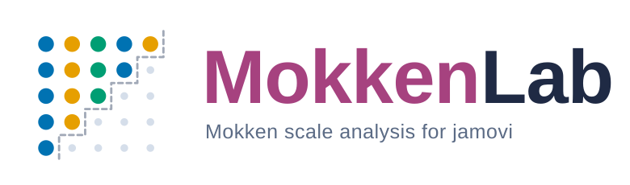
</picture>
</td>
</tr>
<tr>
<td>

*Mokken scale analysis for jamovi: do the items form a scale, which items belong together, and can the order in which they measure the trait be trusted?*
*Every capability of mokken, every option explained — submission to the jamovi Library in preparation.*

</td>
</tr>
</table>

**MokkenLab** is an open-source jamovi module that brings every capability of the [mokken](https://CRAN.R-project.org/package=mokken) R package for nonparametric item response theory to jamovi. It asks whether a set of dichotomous or ordinal items orders respondents consistently on one latent trait, and builds the evidence around that answer: scalability coefficients, automated item selection, the assumptions that make sum scores meaningful, and invariant item ordering.

- **Mokken Scale Analysis:** scalability coefficients for item pairs, items and the whole scale (*Hij*, *Hi*, *H*) with standard errors, Wald-based or range-preserving confidence intervals and tests against a lower bound, by group; reliability (MS, alpha, lambda-2, LCRC), Guttman-error outliers, bounds for dichotomous items and norm statistics.
- **Automated Item Selection (AISP):** Mokken's procedure or a genetic algorithm, at one lower bound or across a sequence of them.
- **Model Assumptions:** monotonicity, invariant item ordering, nonintersection (rest-score and P-matrix methods) and local independence (conditional association), with configurable item response function plots.
- **Two-Level Mokken Scale Analysis** for raters nested in subjects: within, between and ratio coefficients, intraclass correlations and weights for Guttman errors.
- Before every table, a **"How to read" guide**: what the statistic measures, what values to expect and the most common misreading.
- **14 plots** (item response functions, item pairs, P-matrix, violation profile, *Hij* heat map and more), all driven by one shared plot-settings panel, in colourblind-safe palettes.
- Four bundled public datasets (including the clustered-item TROG test), **132 automated tests** (including regression tests from an independent audit) running in CI on every push, and every number checked against direct mokken calls, also in CI.
- Every option with an explanatory paragraph, a key findings summary, native citations in every method-backed table, and every result reported in **English and Spanish**.

*MokkenLab es un módulo de código abierto para jamovi que lleva todas las capacidades del paquete de R mokken, de teoría de respuesta al ítem no paramétrica, a jamovi. Evalúa si un conjunto de ítems dicotómicos u ordinales ordena a las personas de forma consistente en un mismo rasgo latente, y construye la evidencia alrededor de esa respuesta: coeficientes de escalabilidad, selección automática de ítems, los supuestos que dan sentido al puntaje total y el orden invariante de los ítems.*

- *Análisis de escalas de Mokken: coeficientes de escalabilidad de pares de ítems, ítems y escala (Hij, Hi, H) con errores estándar, intervalos de confianza de Wald o que respetan el rango y pruebas frente a un límite inferior, por grupo; fiabilidad (MS, alfa, lambda-2, LCRC), casos atípicos por errores de Guttman, límites para ítems dicotómicos y normas.*
- *Selección automática de ítems (AISP): procedimiento de Mokken o algoritmo genético, con uno o varios límites inferiores.*
- *Supuestos del modelo: monotonicidad, orden invariante de los ítems, no intersección (métodos rest-score y matriz P) e independencia local (asociación condicional), con gráficos configurables de las funciones de respuesta.*
- *Análisis de Mokken de dos niveles para evaluadores anidados en sujetos: coeficientes dentro, entre y su razón, correlaciones intraclase y pesos para errores de Guttman.*
- *Antes de cada tabla, una guía de cómo leerla: qué mide el estadístico, qué valores esperar y la lectura errónea más común.*
- *14 gráficos (funciones de respuesta, pares de ítems, matriz P, perfil de violaciones, mapa de calor de Hij y más), todos controlados desde un mismo panel de ajustes, con paletas aptas para daltonismo.*
- *Cuatro conjuntos de datos públicos incluidos (entre ellos el test TROG de ítems agrupados), 132 pruebas automatizadas (entre ellas pruebas de regresión de una auditoría independiente) corriendo en CI en cada push, y cada número contrastado con llamadas directas a mokken, también en CI.*
- *Cada opción con su párrafo explicativo, un Resumen de hallazgos, citas nativas en cada tabla y cada resultado reportado en inglés y español.*

  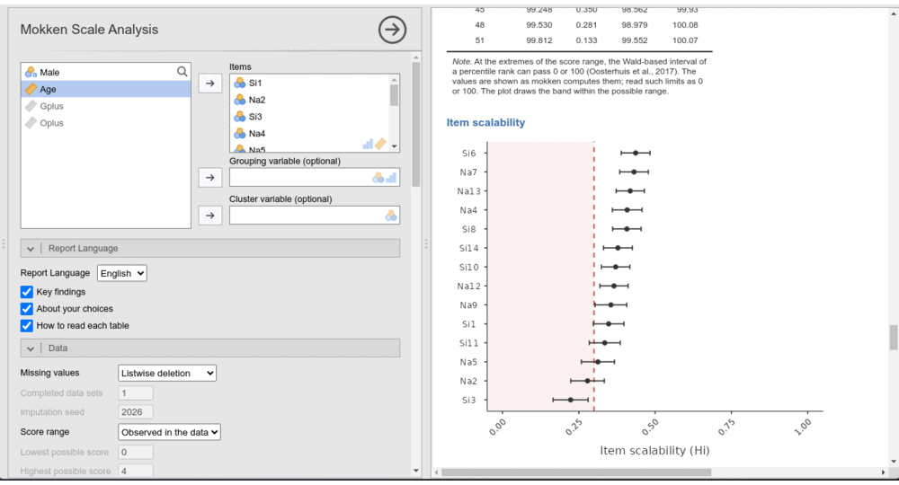

---

### 📊 Estadísticas y Métricas

  
  

  

  

    
    
  

 

  

---
